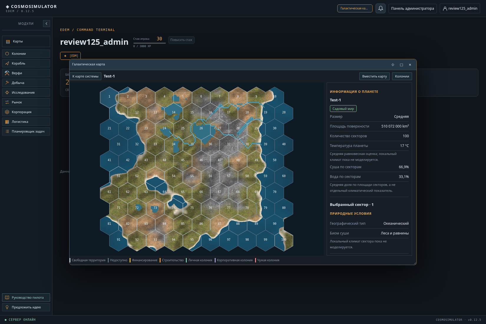

# Текстуры глобальной поверхности · 0.12.5

Подключён предоставленный пользователем `planet_surface_textures_512.zip`: шесть PNG RGB 512×512. Файлы скопированы без изменения содержимого в `internal/server/web/surface-ground-*.png` и встроены в Windows EXE. Генерация новых изображений не выполнялась.

## Материалы

| Исходный файл | Применение |
|---|---|
| ground_grass.png | Леса и равнины садовых миров |
| ground_dry.png | Сухие равнины; примесь сухой почвы пустынных миров |
| ground_sand.png | Низкие морские побережья на суше; песчаные области пустынных миров |
| ground_rock.png | Каменистые миры и переход к скальным высокогорьям других типов |
| ground_snow.png | Ледяные миры и сохранённый холодный биом садовых миров |
| ground_volcanic.png | Вулканическая/лавовая поверхность |

Изображения бесшовны: крайние строки и столбцы действительно совпадают. Билинейный сэмплер использует период 511 px для этих файлов, поскольку 512-я линия повторяет первую. Материалы повторяются через четыре единицы **общих координат планеты**: рисунок не начинается заново на границе каждого гекса и не смещается при движении камеры.

Сухой и холодный биомы берутся из сохранённых секторов. На общей географической решётке строятся плавные веса трёх ближайших биомов; между узлами они интерполируются. Песчаное побережье и переход к камню определяются существующей высотой, уровнем моря и плавными масками. Никакой новой игровой растительности или геологической генерации эти визуальные веса не создают.

Вода определяется прежними сохранёнными высотами/водной маской. PNG грунта применяются только к суше; океаны, озёра и замёрзшая вода сохраняют процедурную палитру, реки — прежние мировые полилинии. Берега, гексы, ресурсы, площади, доли суши и доступность колонизации не меняются. Сохраняется освещение рельефа из 0.12.4.

## Загрузка и производительность

- PNG не загружаются при входе в космический терминал и даже при одной лишь загрузке модуля PlanetUI для администрирования/списка колоний.
- После открытия настоящей поверхности сначала доступна процедурная карта. Затем загружаются только нужные этому типу материалы, и изображение заменяется без сброса камеры, выбранного сектора или карточки.
- Декодированные пиксели кешируются на странице. Повторное открытие, смена языка, масштабирование, перемещение и выбор гекса не загружают PNG заново.
- Текстурный растр готовится один раз на открытие карты или повтор загрузки. Во время движения камеры текстуры заново по пикселям не рассчитываются. Разрешение растра увеличено с 513×385 до 1025×769 для существующей решётки 129×97.
- При отказе части изображений доступные слои нормализуются; если материала нет, остаётся процедурный цвет. При полном отказе карта также остаётся рабочей. Появляется понятная строка и кнопка повторной загрузки, без создания игровых уведомлений в базе.
- Результат поздней загрузки не применяется к уже закрытой карте или другой планете. Графический кеш не содержит данных игрока.

## Проверки

- `go test ./... -count=1` и `go vet ./...` прошли. DB-интеграционные Go-тесты без TEST_DATABASE_URL пропущены: серверные обработчики и схема в этом выпуске не менялись.
- Новый TestSurfaceTextureAssets125 проверяет все шесть **встроенных** PNG: размер, декодирование, непрозрачность и совпадение противоположных краёв.
- Chromium/Playwright с отдельной review-схемой PostgreSQL: пять типов планет, все шесть материалов; отсутствие преждевременных загрузок; ровно шесть запросов изображений после посещения всех типов; повторное использование кеша при навигации, выборе гекса, масштабе и смене языка.
- До и после отрисовки совпали ID, полный объект географии API и PostgreSQL-хеш сохранённой поверхности.
- При искусственном отказе всех PNG проверены рабочая карта, сообщение, повтор загрузки и изменение фактических пикселей Canvas после восстановления изображений.
- Проверены окно 750 px, русская/английская локализации и выход из аккаунта во время задержанных загрузок. Ошибок JavaScript не было.
- В тестовой среде переход от открытия до готовой текстурной карты занял примерно 0,4–0,5 секунды на планету; это наблюдение конкретной среды, не измерение планшета или промышленной нагрузки.

Глобальная поверхность остаётся частью космического Go-сервера. Планетарный секторный сервер и его локальная симуляция не изменялись. Новых миграций нет; существующие поверхности не перегенерируются.
