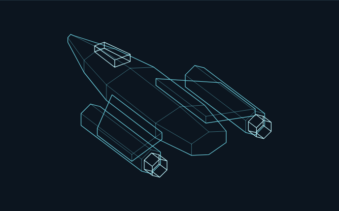
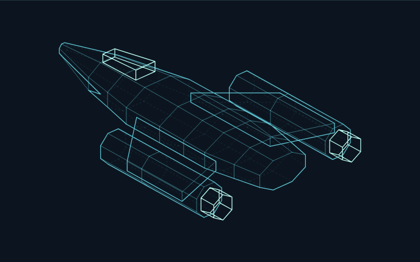
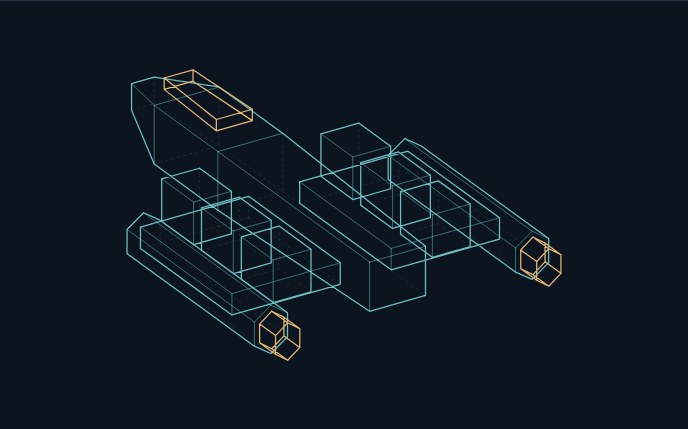
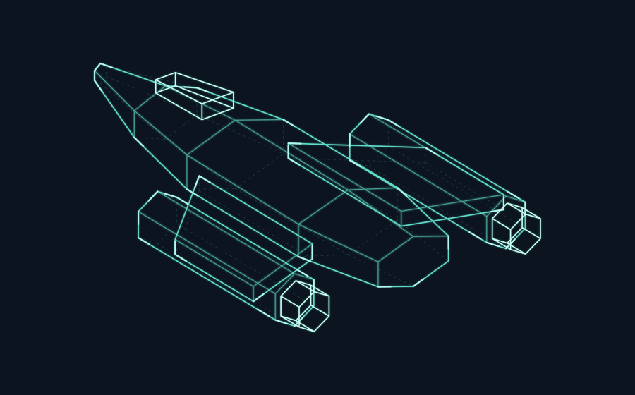
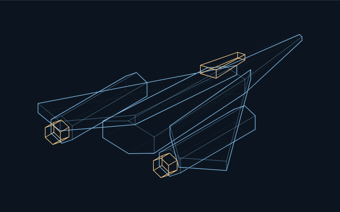
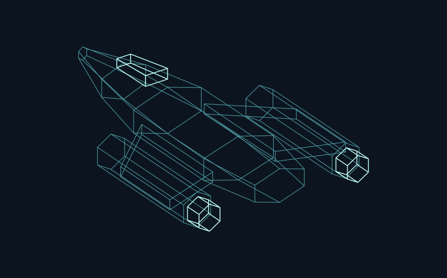

# Голографические SVG — шесть вариантов

Примеры для выбора будущего вида кораблей. Объёмная геометрия корпуса проецируется в SVG: поверхности прозрачные, видны только линии. Названий и характеристик на самих моделях нет.

[Общий лист сравнения](previews/comparison.png) · [HTML-галерея](index.html)

HTML-галерею можно скачать одним файлом и открыть в браузере: все проекции встроены. На GitHub примеры видны ниже; нажатие на превью открывает исходный SVG.

| **01 · Контур** | **02 · Каркас** |
|---|---|
| [](01-contour.svg) | [](02-frame.svg) |
| Лаконичный корпус, минимум линий. | Больше рёбер, дальние грани тонкие и пунктирные. |
| **03 · Модульный** | **04 · Голограмма** |
| [](03-modular.svg) | [](04-hologram.svg) |
| Простой рабочий корабль с внешними контейнерами. Тёплые акценты на кабине и двигателях. | Мягкое зелёное свечение и световые импульсы вдоль корпуса. **Анимирован.** |
| **05 · Дельта** | **06 · Облёт** |
| [](05-delta.svg) | [](06-orbit.svg) |
| Угловатая форма с широкими консолями, другой ракурс. | Полный оборот за 16 секунд. Меняется проекция пространственных вершин. **Анимирован.** |

Для спокойного постоянного отображения предлагаю **01**, для голографического вида — **04**, для просмотра со всех сторон — **06**. Форму корпуса и оформление можно сочетать: например, модульный корабль из 03 со свечением из 04.

Самостоятельные файлы моделей имеют прозрачный фон. Тёмная подложка добавлена в отдельные превью для просмотра на GitHub. Анимация 04 и 06 встроена в SVG; JavaScript и внешние библиотеки им не нужны.

Эти эскизы сохранены для сравнения. В игре с версии 0.4.1 используются пять собственных корпусов: прозрачный каркас, мягкое зелёное свечение, световые импульсы и оборот за 16 секунд. Рабочий генератор: [scripts/generate_ship_holograms.py](../../../scripts/generate_ship_holograms.py).

Исходная геометрия и генератор: [generate.py](generate.py). Пересоздание SVG и автономной HTML-галереи:

```bash
python3 docs/design/ship-holograms/generate.py
```
