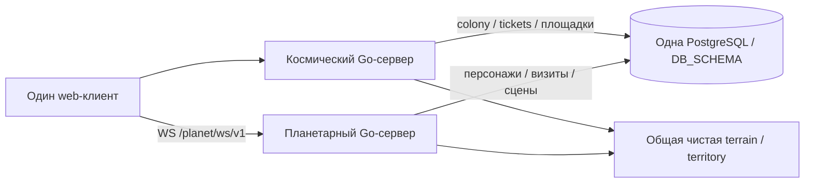

# Архитектура двух служб — проект

## Структура

```text
cmd/cosmosimulator/                 существующая космическая команда
cmd/cosmosimulator-planet/          конфигурация и platform entry новой команды
internal/planetserver/             composition root, routes, Run/shutdown
internal/planet/terrain/            чистая геометрия сектора, вода/реки, dry-components
internal/planet/territory/          чистый граф владельцев и связных территорий
internal/planet/scene/              модели сцен, детерминированный декор, repository
internal/planet/pathing/            навигационная маска, A*, проверка сегментов
internal/planet/presence/           персонаж, визит, handoff redemption, сохранения
internal/planet/runtime/            активные сектора, движение, lease/fencing
internal/planet/transport/          HTTP/WS JSON v1, лимиты, адаптер runtime
internal/colonies/                  космические проекты + управление площадками
internal/platform/postgres/        существующее чистое подключение
internal/platform/windowsservice/  небольшой общий SCM lifecycle, если нужен обоим cmd
internal/server/web/features/planet/sector/  lazy Canvas scene, камера, анимация, WS transport
```

Это функциональные области, не требование создать каждую папку заранее. Маленькие части можно держать файлами в одном пакете до появления разных зависимостей. Никаких `common/utils` со всем SQL, экспортированного старого App или импорта `internal/server` из planet runtime.

Чистые `terrain` и `territory` доступны обоим процессам: космический обработчик вычисляет безопасное место площадки тем же алгоритмом, которым планетарный строит навигацию. Декоративный генератор не меняет эту геометрию.



## Единственный владелец записи

| Данные | Пишет | Другой процесс |
|---|---|---|
| Существующие galaxies/world/ships/users/sessions/companies/company_roles, проекты и финансы | Космический | Узкое чтение для проверки; без EnsureShip/SaveShip |
| Каноническая surface/sectors/revision | Космический | Читает сохранённую версию |
| Площадки, dirty-задачи территорий, режим поверхности | Космический, один обработчик colonies | Читает; не «обеспечивает наличие» собственным INSERT |
| Билеты, резервирование корабля/поколение допуска/запрос отзыва визита | Космический | Читает и блокирует нужные строки при активации |
| Использование билета | Планетарный | Космический читает результат |
| Персонаж, локальные сцены, позиция и состояние визита, runtime lease | Планетарный | Космический читает; не двигает персонажа |
| Миграции | Существующий cosmic runner 784216 | Планетарный только проверяет compatibility marker |

Общий ticket не UPDATE-ят оба процесса: выпуск/отзыв хранится отдельно от его однократного использования. Запрос возвращения космический процесс также пишет в собственный control, а не в принадлежащий runtime визит. Подробные переходы — HANDOFF.

## Режим работы и отказ

Один planet runtime обслуживает схему, но внутри него много активных секторов. DB lease с монотонным fence запрещает запустить второго независимого владельца симуляции; масштабирование на несколько runtime — следующая задача. Это не ограничивает две независимые службы: cosmic и planet работают одновременно.

Предлагаемые defaults: симуляция 20 Hz, отправка 10 Hz, checkpoints 5 s, проверка допуска/авторизации до 2 s, runtime lease 15 s с продлением каждые 5 s, выгрузка пустой сцены через 60 s. Это отправные настройки, **не измеренная производительность**. Просроченный lease/потеря связи с БД останавливают приём движения; runtime не продолжает бесконечно жить только в RAM.

Движение не держит SQL-транзакцию. Короткие команды входа/перехода/выхода используют tx и fencing, путь рассчитывается заранее на неизменяемом snapshot. Космический tick не ждёт WS или генерации сцены.

## Сеть и запуск

Предпочтительно один HTTPS origin: `/` и `/api/*` — cosmic; `/planet/api/v1/*` и `/planet/ws/v1` reverse proxy направляет в planet. Это сохраняет существующую cookie и CSP `connect-src 'self'`. Для отдельного внешнего origin потребуется явная конфигурация Origin/CSP/CORS; wildcard не используется.

Новые параметры: `PLANET_HTTP_ADDR` (по умолчанию loopback `127.0.0.1:8081`), `PLANET_PUBLIC_URL` у cosmic для клиентского маршрута/проверки доступности, `PLANET_ALLOWED_ORIGINS` у planet; `DATABASE_URL`, `DB_SCHEMA`, настройки доверенного proxy и secure-cookie согласуются с существующими. Частоты/таймауты объединить в небольшой проверяемый config, не создавать десятки пользовательских опций без необходимости.

`GET /planet/api/v1/health/live` проверяет процесс, `/health/ready` — DB, marker схемы и lease. Неготовый runtime отвечает 503 и не принимает высадки. Cosmic показывает независимый статус с ограниченным таймаутом; не проксирует каждую команду движения и продолжает работать при остановленном planet.

SCM service name `CosmosimulatorPlanet`, отдельный EXE/журнал, stop → запрет новых входов → checkpoint → закрытие WS → освобождение lease → pool.Close. Общий SCM адаптер получает функцию Run, не знает о cosmic tick.

## Клиент

Космический сервер продолжает отдавать web shell. Секторный код/атлас/PNG подгружаются при высадке; API snapshots и приватные сцены не попадают в публичный AssetCache. Переиспользуются I18n, UI.confirm/notify, epoch/RequestScope, общий lifecycle и форматирование. Состояние сектора не записывается в localStorage как игровая БД.

Динамический Canvas — отдельный режим, а не вторая страница логина. При выходе/logout уничтожаются WS, timers, приватная сцена и pending callbacks. Нельзя использовать демо HTML из архива как production клиент: там другая география, прямолинейное движение и нет сервера.
