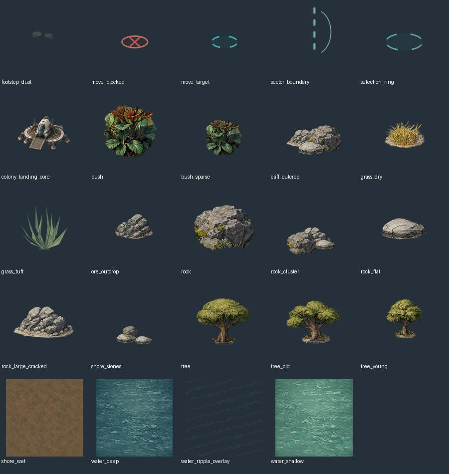

# Графика: проверка пака v2 и полное ТЗ

> Ниже — исходное обследование P2-0. С 0.22.0 изображения технически подключены в [P2-8](../P2-8/REPORT.ru.md); художественные ограничения preview сохраняются.

Статус: комплект **достаточен для технического прототипа**, но не объявляется окончательным художественным результатом. Никакие новые игровые изображения здесь не генерировались. Оригинальные изображения не исправлялись; контактный лист создан только для просмотра. HTML/Python из архива не запускались.

[Оригинальный ZIP](../../design/planet-colony/artpacks/cosmosimulator_planet_2d_artpack_v2.zip) сохранён побайтно. SHA256: `7ff521b968e6558482bc42ad76878f7be438e0ad0310c9a1b67729bbe26545be`.

Пак сохранён как исходный архив документации, а не как подключённые web assets. В действующем EXE по-прежнему только прежние ресурсы; наличие ZIP не означает выполненную интеграцию P2-8.

## Что проверено самостоятельно

- 110 файлов, 103 PNG (включая demo), все PNG декодируются; RGB 14, RGBA 89. В assets 98 PNG; атлас и его отдельные frames — альтернативные поставки одних кадров, не разные анимации.
- Шесть ground PNG — 512×512 RGB, побайтно совпадают с уже встроенными surface-ground файлами. Разница противоположных граничных пикселей 0. Это подтверждает совпадение краёв, но не само по себе отсутствие заметного повторения рисунка на большой площади.
- Deep/shallow/shore_wet — 512×512 RGB, противоположные края совпадают. Ripple overlay — 256×256 RGBA; максимальная разница каналов противоположных краёв 8/255. Его нужно доработать для точного wrap либо применять с затуханием/непериодической маской; не называть строго бесшовным.
- Атлас 896×1024 RGBA: восемь строк S, SW, W, NW, N, NE, E, SE; семь колонок idle + 6 walk. Все 56 отдельных кадров 128×128 совпали с соответствующими вырезами атласа.
- В E/W по 6 уникальных walk-изображений, в остальных направлениях по 3 побайтно различных. Повтор кадров сам по себе допустим для длительности позы, но **шесть ячеек не доказывают полноценный шестипозный цикл**.
- Все пути `manifest.assets` физически существуют. Есть размеры, anchors и приблизительные footprints для базовых/природных/посадочного объектов; отдельно atlas metadata. Для FX нет столь же полного описания anchor/масштаба/поведения.
- При визуальном просмотре хорошо читаются природные объекты и отдельная платформа с капсулой. Диагональные позы приблизительные, в некоторых ракурсах направление недостаточно отличается; walk выглядит как адаптация нескольких иллюстраций, не законченный согласованный turnaround. Сам README пакета прямо указывает `0.2.0-preview`, QA отмечает те же ограничения и отсутствие layered исходников.

[Независимые результаты](art-review/inspection.json) · [Атлас](art-review/colonist-atlas.png) · [Контактный лист объектов](art-review/objects-contact.jpg).

## Реестр пригодности

| Материал | Есть | Решение |
|---|---|---|
| 6 ground textures | Да, уже применяются в overview | Сохранить, использовать UV/маски движка; не перерисовывать |
| Water deep/shallow/shore wet + ripple | Да | Три основы пригодны; рябь требует описанного выше уточнения |
| Tree / old / young, bush / sparse, grass / dry | Да | Достаточно для первой сцены; согласовать anchors/масштаб и небольшие остатки грунта у контакта |
| Rock / flat / cracked / cluster, cliff, shore stones | Да | Подходят; footprint проверять на реальном масштабе, не по площади всей картинки |
| Отдельный landing object | Да, colony_landing_core.png | Платформа визуально отличается от habitat. Это игровой объект площадки, а не физический корабль/ресурс colony_core |
| Персонаж 8 направлений, idle + walk | Файлы есть | Технически можно воспроизводить; финально доработать диагонали, шаг и согласованность поз |
| Move target/blocked, ring, boundary, dust | Да | Подходят как основа; дополнить FX metadata |
| Полностью редактируемые художественные исходники | Нет | В паке PNG и scripts производных сборок. Это не PSD/KRA/ASE со слоями |
| Habitat, panel, container, node, mine | Да | Сохранить в архиве; не размещать автоматически и не включать их игровые механики в P2 |

## Текст для передачи дизайнеру

**Цель.** Доработать предоставленный Cosmosimulator Planet 2D Art Pack v2 до согласованного комплекта первой многопользовательской сцены. Сохранить существующий стиль и хорошие PNG. Не создавать коллаж вместо отдельных игровых ресурсов и не менять изображения, не требующие исправления.

**Стиль и камера.** Чёткая рисованная научно-фантастическая графика, естественная приглушённая палитра, вид сверху с небольшим наклоном; видны верх и боковые стороны объектов. Без горизонта, перспективного уменьшения дальних объектов, обязательной изометрии и магического свечения. Освещение сверху слева единообразно. Крупные падающие тени лучше отдельным слоем; не запекать участок земли/фон вокруг объекта.

**Масштаб.** Согласовать персонажа, дерево, куст, валун и посадочную платформу на одной контрольной сцене. Стартовый render scale — 16 logical px на игровую единицу, персонаж atlas draw около 96 px по холсту при zoom=1. Это референс согласования, не требование физически растянуть все исходные PNG. Не увеличивать маленький куст до высоты дерева только потому, что его холст тоже 512×512. Для каждого изображения указать draw size в logical px, anchor [0..1] и footprint в той же системе; preview размеры manifest приблизительны.

**Персонаж — основная доработка.** Сохранить скафандр, силуэт, цвета и читаемость. Восемь реальных направлений S/SW/W/NW/N/NE/E/SE, одинаковая высота камеры. Для каждого: 1 idle и 6 согласованных поз ходьбы. Диагональные позы должны показывать соответствующий поворот корпуса/шлема/рюкзака, а не только зеркальное отражение или сдвиг ног фронтального кадра. Ступни опираются на одну согласованную ground point; корпус не скачет по холсту. Сохранять объём головы/рюкзака и толщину конечностей. Шаг циклический без скачка последнего кадра в первый; длительность около 135 ms/кадр как исходный ориентир, точный темп согласуется со скоростью игры. Кадры не обязаны быть все уникальными, если повтор сознательно формирует тайминг, но движение должно читаться как ходьба без скольжения.

Поставка: отдельные RGBA PNG 128×128 с прежними именами и atlas 896×1024 без изменения row/column order, JSON с frame size/rect/duration/anchor. Если новый качественный оригинал требует большего разрешения — сохранить high-res исходник и отдельно согласовать новый export format; не менять его скрытно. Проверить анимацию на реальном масштабе и при увеличении, на светлом/тёмном фоне.

**Грунт.** Шесть имеющихся RGB PNG 512×512 сохранить. Без деревьев/камней/границ биома в основе. Бесшовность X/Y, контроль 3×3 и при уменьшении. Различие сухой почвы, песка и камня читается без чрезмерного контраста. Видимый масштаб зерна согласовать с персонажем. Карта не собирается из отдельно нарисованных гексов; маски задаёт движок.

**Вода и берега.** Сохранить deep/shallow/shore_wet, доработать периодичность ряби или поставить пометку об ограничении её применения. Прозрачный ripple overlay, без встроенной конкретной формы озера/реки. Берег, ширина русла и мелководье определяются канонической географией программно. Не нужны готовые «река налево/направо» или огромная готовая карта. Пена/влажный край — необязательные отдельные мягкие overlays с чистой альфой; не закрашивать ими проходимую сушу в воду визуально.

**Природа.** Использовать существующие варианты: 3 дерева, 2 куста, 2 травы, валун и каменные варианты, cliff/shore stones. Не подменять их случайно повёрнутыми картинками с несовместимым светом. У деревьев опора у ствола, коллизия около основания; крона остаётся визуальным перекрытием. У камня footprint по нижнему основанию. Пучки травы декоративные, без обязательной коллизии. Удалить только посторонние фрагменты грунта/ореолы, не настоящие корни/породу. Снег/редкие биомы во второй очереди можно оформить имеющимися материалами без заказа полного набора флоры каждой планеты заранее.

**Посадочный модуль.** Сохранить дизайн отдельной `landing/colony_landing_core.png`: маленькая платформа/сооружение с пандусом, не город, не habitat и не копия космического корабля игрока. Файл имени legacy не означает предмет colony_core. Прозрачный фон, достаточно места у пандуса для появления нескольких персонажей. Указать footprint, ground anchor, ориентацию выхода и polygon/rectangle безопасной spawn-zone относительно anchor. Платформа сама не хранит ресурсы и не производит продукцию. Сигнальные огни допустимы отдельными 2–4 кадрами/слоем, но не обязательны для первой готовности. Значок площадки для глобальной карты можно получить из её силуэта/общего UI-символа; это не отдельный большой рисунок поверхности.

**Маркеры и FX.** Сохранить move_target, move_blocked, selection_ring, sector_boundary, footstep_dust. Описать anchor (обычно центр), draw size, слой (ground/over actor), duration/loop, tint rules и alpha. Маркер границы не определяет право перехода: это информация сервера. Читаемость на траве/песке/снеге/камне; анимация не должна напоминать сильное магическое свечение. Движение камеры/масштаб не меняют геометрию маркеров в мире.

**Файлы и прозрачность.** Объекты — RGBA PNG, прозрачный фон без шахматной сетки и запечённых рамок. Оpaque внутренности металла/скафандра/камня, сглаживание только у границ и обоснованных тонких деталей. Не JPEG с расширением PNG. Грунт RGB, FX RGBA. По возможности положить редактируемые layered исходники отдельно; если инструмент их не умеет, честно указать отсутствие. Python сборщик и PNG не выдавать за послойный художественный исходник.

**Manifest и поставка.** Сохранить имена/структуру v2; у изменённых файлов указать art version и перечень изменений. Manifest включает image dimensions, draw size, anchors, footprint shapes и units, для персонажа direction/frame rect/duration; для FX loop/layer/anchor. Предоставить ZIP + обзор PNG + анимационное превью idle/walk по восьми направлениям. Не изменять игровые collision rules/географию внутри дизайнерского demo.

**Приёмка.** Все файлы открываются; atlas/отдельные frames совпадают; нет обрезанных частей/ореолов; направление и цикл ходьбы читаются; масштабы согласованы на одной сцене; точки опоры/footprint проверены при draw=1; вода/грунт не образуют швов. Демо-сцена — только демонстрация рисунков. Качество реальной интеграции и FPS проверяются после подключения к игре.

## Граница согласования

Пак v2 закрывает прежнее отсутствие большинства категорий. Для P2-1 и серверных частей ждать всех художественных исправлений не требуется после утверждения архитектуры. Однако P2-8 нельзя объявить окончательно принятым только потому, что PNG/JSON валидны. Если пользователь сознательно принимает preview-анимацию для первого релиза, это нужно зафиксировать как отдельное решение с перечисленными ограничениями.
