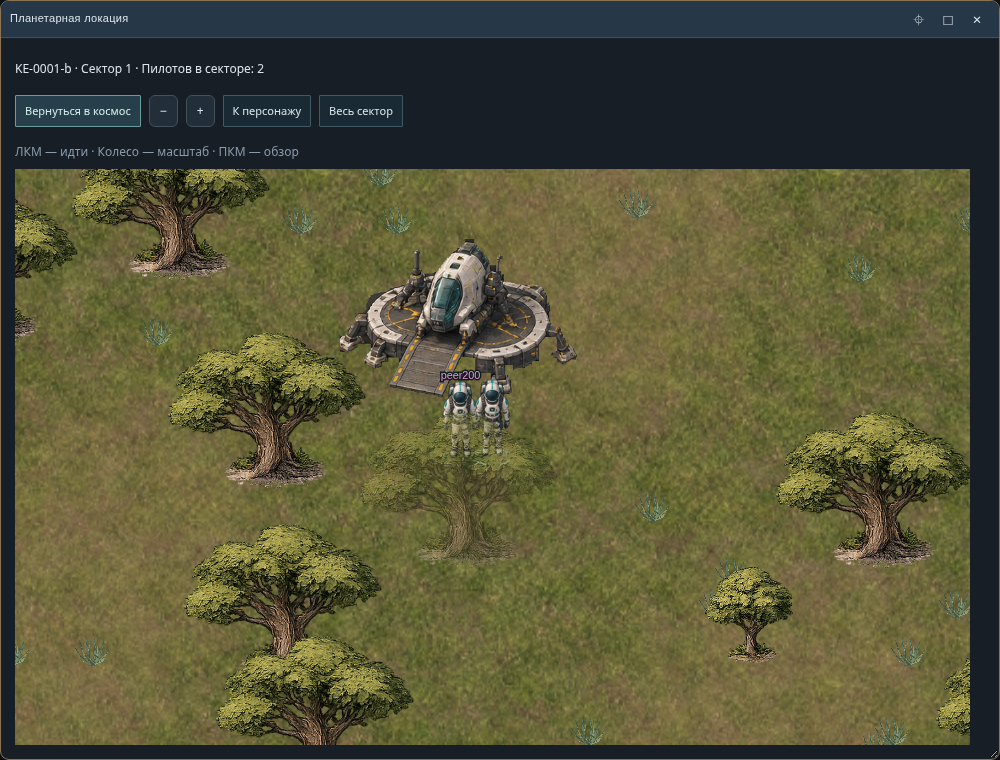
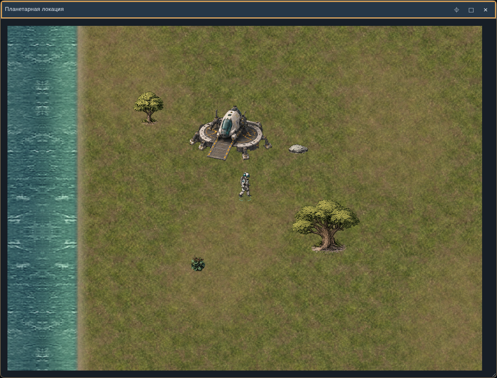

# P2-8 · текстуры и анимации · 0.22.0

В локальной сцене теперь используются изображения из предоставленного `cosmosimulator_planet_2d_artpack_v2.zip`: грунт, вода, природные объекты, посадочный модуль, персонаж и маркеры. Это техническая интеграция существующего preview-комплекта. Окончательный художественный приём остаётся открытым: диагональные ракурсы и некоторые циклы ходьбы требуют доработки.

- [Отчёт, архитектура и проверки](REPORT.ru.md).
- [Опоры, размеры и оставшиеся задания дизайнеру](ART.ru.md).
- [Происхождение, размеры и SHA256 всех используемых PNG](assets.json).
- [Настройка двух служб и подключения](../P2-4/README.ru.md).
- [Переходы между секторами](../P2-7/README.ru.md).

## Как посмотреть

1. Обновить обе службы. Открыть завершённую доступную колонию с действующей площадкой и выбрать «Высадиться».
2. ЛКМ выбирает цель; маршрут и столкновения считает сервер. Колесо меняет масштаб, ПКМ перемещает камеру. «К персонажу» возвращает слежение, «Весь сектор» показывает границы.
3. При движении проигрывается ходьба по направлению, полученному от сервера; после остановки — соответствующая поза покоя. Вода имеет слабую рябь, над целью отображается маркер. Непроходимая цель получает другой маркер после ответа сервера.
4. При наведении у основания дерева, камня или платформы появляется подсветка и краткая подпись. Крона над своим персонажем становится полупрозрачной.
5. У разрешённой границы работает прежнее подтверждение перехода. В соседнем секторе без собственной площадки её изображение отсутствует.

Если часть PNG недоступна, появляется сообщение «Часть графики недоступна» и кнопка повторной загрузки. Она переподключает текущий визит и повторяет загрузку; не создаёт новую колонию или персонажа. До восстановления графики управление остаётся под контролем сервера.

## Обновление с 0.21.0

1. Остановить planet и cosmic; сохранить резервную копию игровой схемы.
2. Заменить **оба** EXE на 0.22.0: cosmic содержит новые web assets, planet — дополнительные публичные данные сцены и направления персонажей.
3. Запустить cosmic, затем planet с прежними параметрами. Новых SQL-миграций и GRANT в этом выпуске нет: marker остаётся **7**. При переходе со старых версий сначала выполнить инструкции и права P2-4/6/7.
4. В «Статус служб» проверить версии 0.22.0; planet должен сообщать `stage=P2-8`, `schema_version=7`, `gameplay_ready=true`.
5. Перезагрузить браузер, чтобы он получил согласованные JS-модули новой версии.

Сохранённые сцены v1, география, декор, колонии и координаты не пересоздаются. Новых параметров окружения нет. Предыдущие EXE сохранены в `downloads`. Для возврата именно к 0.21.0 остановить службы, вернуть обе сборки и перезагрузить браузер: P2-8 не меняет схему и формат сохранённых сцен; marker вручную не изменять. Для более старых версий действуют их собственные ограничения миграций.

