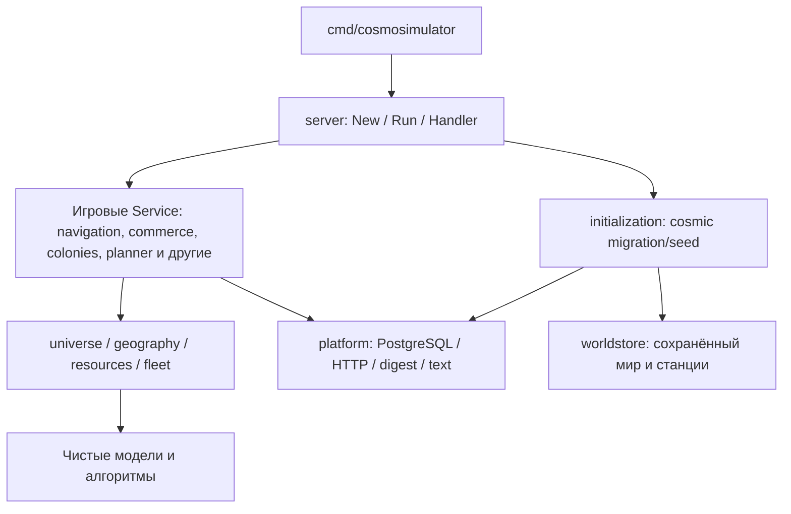

# Go-сервер после разделения пакетов · 0.14.0

В 0.13.0 был разделён клиент и выделено подключение PostgreSQL; игровой Go-код оставался в одном `server`. В 0.14.0 разобран именно этот монолит: из корня `internal/server` вынесены модели, игровые правила, транзакционные операции, фоновые обработчики и административные экраны. Корень содержит три Go-файла, отвечающие за сборку приложения, маршруты и запуск. Интеграционные тесты находятся в `internal/server/integration`.

## Где искать код

Все пути ниже относительно `internal/`.

| Пакет | Ответственность |
|---|---|
| `server` | `New`, конфигурация, соединение экземпляров Service, HTTP routes/security headers, Run/shutdown, embedded SQL/web. Игровых команд здесь нет |
| `initialization` | Инициализация **космического** мира: прежние SQL-миграции, seed и upgrade в прежнем порядке. Получает SQL filesystem явно |
| `account` | Учётные записи, bcrypt, сессии, trusted proxy identity/rate limiting, профиль и стаж |
| `universe` | Чистые модели галактики/систем/планет, генерация, гиперкоридоры, регионы, распределение объектов и скрытой геологии |
| `worldstore` | Загрузка сохранённого мира, transaction-aware read, кеш/revision, станции, безопасное применение и удаление галактик |
| `geography` | Каноническая сетка поверхности, реки/вода/hex-сектора, deterministic generation и sampler |
| `resources` | Каталог и метаданные ресурсов, характеристики добытчиков и DTO квоты |
| `fleet` | Корабль, каталог корпусов, текущие характеристики, read/save/settle, покупка/переименование, ограничения флота |
| `navigation` | Полёт, локальное перемещение, порталы, маршруты, телепортация администратора, продолжение полёта и сканирования |
| `gameplay` | Чтение игровых настроек и звёздная дата |
| `mining` | Квоты, резервирование добычи, единый BeginExtraction для ручного действия и планировщика, завершение добычи |
| `research` | Видимость исследованных объектов, постановка исследования и его read model |
| `wallet` | Условное списание/зачисление, технический диапазон и причина операции в уже открытой транзакции |
| `inventory` | Чтение и запись персонального станционного склада в транзакции вызывающего |
| `logistics` | Проверка доступа к источникам/получателям, корпоративные склады, атомарный перенос груза, multi-select API |
| `commerce/catalog` | Специализации, ассортимент/котировки станций, ассортимент и цены верфей, их инициализация |
| `commerce` | Торговля, брони, перевозки/доставка, кошельки ботов и прежняя продажа руды |
| `corporations` | Корпорации, членство, роли/полномочия, казна, корпоративные команды и каталог |
| `planner` | Очереди по кораблям, приоритеты, переходы состояния и выполнение автоматических задач |
| `colonies` | Поверхности в БД, права на сектор, проекты/взносы/возвраты/колонии, settings/reset/admin preview |
| `simulation` | Единственный космический tick и порядок advance activities; orchestration нескольких подсистем |
| `terminal` | Сводный snapshot космического терминала, системная карта/fleet API, диспетчер старых HTTP-команд. Команды делегируются навигации, торговле и корпорациям с тем же tx |
| `notifications` | Inbox, отметки прочтения/удаление/сообщения |
| `events` | Запись игровых событий в транзакции; действующие DB triggers сохранены |
| `ideas` | Предложения игроков и административное рассмотрение |
| `administration` | Пользователи/выдача ресурсов, настройки, tick action, журналы и публичная агрегированная статистика сервера |
| `benchmark` | Изолированные HTTP-нагрузки в временной схеме, отмена и метрики. Создание тестового приложения передаётся функцией из composition root |
| `commands` | Совместимый входной DTO текущего космического API; это не универсальный протокол будущей планетарной службы |
| `platform/postgres` | DSN/schema/search_path/pool, узкие Querier/DBTX и QueryMaps |
| `platform/httpkit` | Ограниченный JSON, HTTP-ошибки, deadline, gzip и разбор trusted proxy configuration |
| `platform/idempotency` | Прежний digest тела операции, без изменения ключей и сохранённых receipts |
| `platform/text` | Проверка UTF-8/управляющих символов без зависимости от игровых экранов |
| `architecture` | Тест компиляторных границ: features не импортируют server, platform не импортирует игру, pure модели не импортируют I/O |

Пакет не обязан иметь четыре одинаковых подкаталога repository/service/handler/model. В небольшом feature его файлы разделены по настоящим операциям. Общий `utils/common` со всеми игровыми SQL не создавался.

## Как устроены зависимости

Каждая Service получает только используемые ею зависимости: pool, account, worldstore либо другой конкретный feature. Глобальный App не передаётся во все пакеты. Импортов `internal/server` из production features нет. Benchmark получает явные фабрики открытия временной схемы и создания полного HTTP handler: обратного импорта composition root или второй копии приложения нет.

`server.New` только связывает экземпляры; он не мигрирует БД и не запускает tick. `Run` явно вызывает космическую инициализацию и затем один simulation loop. Будущий планетарный процесс не должен вызывать `server.Run` или `initialization.OpenDatabase` ради обычного подключения.

## Транзакции и совместимость

- `pgx.Tx` проходит в wallet, inventory, fleet, mining, corporations и colony helpers как прежде. Внутри такого helper не создаётся новый pool/вторая транзакция.
- Advisory locks, row locks, общий порядок tick и атомарность коммита сохранены. Общая world mutation lock не удалена под видом рефакторинга.
- Обновление мирового кеша остаётся согласованным с commit. Для портального изменения `worldstore.Commit` держит тот же mutex до commit и сбрасывает кеш только при успехе.
- Transactional world reader использует переданный tx и не ждёт занятого mutex обычного pool reader. Регрессия насыщенного пула перенесена к владельцу кеша в `worldstore/cache_test.go`.
- Все 496 SQL-литералов исходного runtime сохранены. Новых SQL-миграций, изменений идентификаторов, правил экономики, маршрутов HTTP или JSON-полей нет.
- Генерация галактики и четырёх типов поверхности сверена по SHA256 сериализованных данных старого 0.13.0, commit `d52eb29`. Также совпали четыре набора значений публичного sampler. Эталоны и проверка — `geography/testdata/v0.13.0-hashes.json`, `geography/compatibility_test.go`.
- Legacy station-core membership теперь рассчитывается через `sync.OnceValue` при первом запросе политики станций. Простой импорт geography/universe не создаёт галактику даже в памяти для этого служебного списка.

## Что переиспользует планетарная служба

1. `platform/postgres.Open` — подключение без migration/seed/tick с тем же точным DB_SCHEMA.
2. `geography.PlanetSurface`, `PlanetSector`, `SurfacePoint`, `Sample` — чтение сохранённой канонической географии. Генерацию/изменение поверхности выполняет только космический владелец; локальная сцена не создаёт другую береговую линию.
3. Модели `universe.Planet`/`Star`, каталог `resources`, совместимые идентификаторы и параметры объектов — по реальному контракту сектора.
4. Проверку существующей сессии через account и общие JSON/deadline/text/digest helpers, если их текущие ограничения подходят новому endpoint.

Наличие функции в отдельном пакете не даёт второму серверу права параллельно изменять космический кошелёк, ships.cargo или colony owner. Для межсервисной передачи нужны отдельный идемпотентный протокол и единственный ответственный обработчик. Полный [single-writer контракт](../service-boundaries.ru.md) действует и после переноса.

Движение персонажей, sector runtime, отдельные DB roles и handoff высадки этим выпуском не реализованы. Общие модели подготовлены; игровое состояние по-прежнему обслуживает один космический процесс.

## Правила следующих изменений

Начинать с feature из таблицы. Чистые расчёты держать без HTTP/pgx, транзакционный use case — у владельца изменяемых данных. Новый cross-feature вызов передавать явно, не импортировать `server.App`. Интерфейс вводить по реальной потребности вызывающего; конструктор или thin facade ради количества слоёв не нужен.

При переносе private type между пакетами использовать именованные поля composite literal. Не менять одновременно SQL-порядок, схему, игровой баланс и структуру пакетов. Старые receipts и JSON tags требуют совместимости независимо от новых Go-имён.

Интеграционные проверки запускаются только в одноразовой `_test` базе. Настоящие credentials не сохраняются в исходниках/логах. Node/Playwright остаются dev-only, Windows поставляется одним EXE. [Результаты выпуска](IMPLEMENTATION-0.14.0.ru.md).
